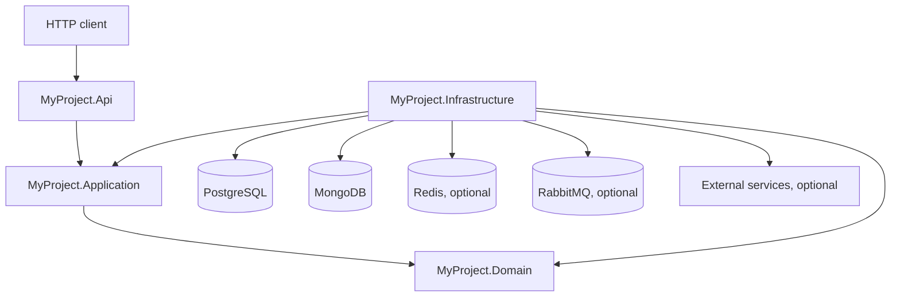

# .NET Backend Foundation

A reusable backend starter built with **.NET 10**, **Domain-Driven Design (DDD)**, **CQRS**, and replaceable infrastructure adapters. It provides a working structure for REST APIs and service-side use cases while keeping external systems behind application interfaces.

The `User` and `UserActivity` features are the reference implementation. The integrations listed below are optional building blocks; they are not all enabled or used by the current API.

## Contents

- [What is included](#what-is-included)
- [Architecture](#architecture)
- [Repository layout](#repository-layout)
- [Current API](#current-api)
- [Prerequisites](#prerequisites)
- [Run locally](#run-locally)
- [Configuration](#configuration)
- [Docker Compose](#docker-compose)
- [Build, test, and CI](#build-test-and-ci)
- [Adding a feature](#adding-a-feature)

## What is included

- ASP.NET Core API with controller-based routing, request validation, and consistent Problem Details responses.
- MediatR-based commands, queries, handlers, and pipeline behaviors for validation, transactions, logging, and performance measurement.
- A domain layer with entities, value objects, domain events, and business rules.
- PostgreSQL persistence through Entity Framework Core, plus MongoDB storage for user activity records.
- Optional adapters for Redis caching, RabbitMQ messaging through MassTransit, Brevo email, local or S3-compatible file storage, JWT authentication, Hangfire jobs, and OpenTelemetry export.
- Serilog request and application logging, health checks, configurable rate limiting, request timeouts, CORS, and OpenAPI.

Optional adapters are controlled by configuration. Enabling an adapter may also require credentials, a running dependency, or additional application use cases.

## Architecture

The API depends on application use cases. The application layer owns the interfaces it needs; infrastructure implements those interfaces and connects them to databases and external services. The domain contains business concepts and rules without depending on ASP.NET Core or storage technologies.



### Typical request flow

1. The API binds and validates the HTTP request.
2. A controller sends a command or query through MediatR.
3. An application handler coordinates the use case and applies domain rules.
4. The handler uses application or domain interfaces; infrastructure supplies their implementations.
5. The API converts the result to an HTTP response. Known domain and application errors become Problem Details with an error `code` and a `traceId`.

The application pipeline registers logging, validation, transaction, and performance behaviors. Domain events raised by entities can be dispatched after a successful unit-of-work save.

## Repository layout

| Path | Responsibility |
| --- | --- |
| `src/MyProject.Api` | HTTP controllers, request/response models, authentication setup, middleware, health endpoints, and OpenAPI. |
| `src/MyProject.Application` | Commands, queries, handlers, DTOs, validation and pipeline behaviors, and interfaces required by use cases. |
| `src/MyProject.Domain` | Entities, value objects, domain events, domain errors, and business rules. |
| `src/MyProject.Infrastructure` | PostgreSQL and MongoDB persistence, messaging, cache, email, file storage, identity, jobs, and observability adapters. |
| `src/MyProject.Contracts` | A separate integration-contract project directory. It is not currently included in `MyProject.sln`; the solution uses the projects listed below. |
| `MyProject.sln` | API, Application, Domain, and Infrastructure projects. |
| `Directory.Packages.props` | Central NuGet package versions. |
| `Directory.Build.props` | Shared compiler and analyzer settings. |
| `global.json` | .NET SDK selection. |
| `Dockerfile` | Multi-stage API image build. |
| `compose.yaml` | API and local dependency container definitions. See [Docker Compose](#docker-compose) for current setup notes. |
| `.github/workflows/ci.yml` | Restore and dependency audit, formatting, build, test, and CodeQL analysis. |

## Current API

The API exposes the following routes. Requests and responses use JSON.

| Method | Route | Description |
| --- | --- | --- |
| `POST` | `/api/users` | Create a user. `Code`, `Name`, and `Email` are required; code and email must be unique. |
| `GET` | `/api/users/{id}` | Retrieve a user by GUID. |
| `POST` | `/api/users/{userId}/activities` | Record an activity for an existing user. `Type` is required; `Details` is optional. |
| `GET` | `/api/users/{userId}/activities?limit=50` | List recent activities. `limit` must be between 1 and 100; the default is 50. |

### Create a user

```http
POST /api/users
Content-Type: application/json
```

```json
{
  "code": "USR-001",
  "name": "Avery Chen",
  "email": "avery@example.com"
}
```

The API returns `201 Created` with the created user and a `Location` header pointing to its `GET` route.

### Record an activity

```http
POST /api/users/00000000-0000-0000-0000-000000000001/activities
Content-Type: application/json
```

```json
{
  "type": "signed-in",
  "details": "Signed in from the web app"
}
```

The activity ID and occurrence time are generated by the application. Activities are stored in MongoDB and can be read using the corresponding `GET` route.

### Responses and authentication

- Request binding and annotation failures return `400 Bad Request` with validation details.
- Application and domain errors use `application/problem+json` and include a stable `code` and a `traceId` for troubleshooting.
- The `Identity:Enabled` option is `false` by default. When enabled, JWT bearer authentication and a fallback authorization policy require authentication for API endpoints. Health and OpenAPI endpoints remain anonymous.
- This repository does not include a login or token-issuing endpoint. Configure a trusted issuer or add an identity use case before enabling JWT authentication for interactive clients.

## Prerequisites

- .NET 10 SDK. The repository pins SDK `10.0.100` in `global.json` and allows roll-forward to a later feature band.
- PostgreSQL and MongoDB for the default API configuration. PostgreSQL is enabled by default and requires `ConnectionStrings:DefaultConnection`. MongoDB is also enabled by default and listens at `mongodb://localhost:27017` in `appsettings.json`.
- `dotnet-ef` compatible with EF Core 10 if you need to create or apply database migrations.
- Docker is optional; it can run local dependency containers once the Compose setup gaps listed below are addressed.

Redis, RabbitMQ, email, file storage, identity, background jobs, and OTLP export are disabled by default.

## Run locally

### 1. Restore and build

From the repository root:

```sh
dotnet restore MyProject.sln
dotnet build MyProject.sln --configuration Release --no-restore
```

### 2. Configure the PostgreSQL connection

Set `ConnectionStrings__DefaultConnection` in the environment. ASP.NET Core maps double underscores to configuration section separators.

PowerShell:

```powershell
$env:ConnectionStrings__DefaultConnection = "Host=localhost;Port=5432;Database=myproject;Username=postgres;Password=your-local-password"
```

Bash or zsh:

```sh
export ConnectionStrings__DefaultConnection='Host=localhost;Port=5432;Database=myproject;Username=postgres;Password=your-local-password'
```

Keep real credentials out of source control. Use environment variables, .NET User Secrets, or your deployment platform's secret store.

### 3. Create and apply the initial PostgreSQL migration

There are no Entity Framework migrations in the repository yet, and the API does not create the PostgreSQL schema at startup. Generate and apply an initial migration before using the user endpoints. Run these commands from the repository root, in the same shell where the connection string is set:

```sh
dotnet ef migrations add InitialCreate --project src/MyProject.Infrastructure --startup-project src/MyProject.Api --context AppDbContext --output-dir Persistence/PostgreSql/Migrations
dotnet ef database update --project src/MyProject.Infrastructure --startup-project src/MyProject.Api --context AppDbContext
```

Commit the generated migration files so other developers and deployments can create the same schema. MongoDB creates its user-activity index during application startup; the MongoDB server must be reachable when the API starts.

### 4. Start the API

```sh
dotnet run --project src/MyProject.Api
```

The `http` launch profile serves the API at `http://localhost:5117`. In the Development environment, the OpenAPI document is available at `http://localhost:5117/openapi/v1.json`.

Health endpoints:

- `GET /health/live` confirms that the process is running. It does not check dependencies.
- `GET /health/ready` runs the registered dependency health checks, including PostgreSQL and MongoDB when those adapters are enabled.

## Configuration

Configuration comes from `appsettings.json`, environment-specific JSON files, environment variables, and other ASP.NET Core configuration providers. Environment variables take precedence over JSON settings; use `Section__Key` to set nested values.

| Section | Default | Purpose and important settings |
| --- | --- | --- |
| `ConnectionStrings:DefaultConnection` | Not set | Required when PostgreSQL is enabled. Used by EF Core and Hangfire when background jobs are enabled. |
| `PostgreSql` | Enabled | `PostgreSql:Enabled` controls EF Core repositories and the PostgreSQL health check. |
| `MongoDb` | Enabled | `ConnectionString` and `DatabaseName` configure MongoDB activity storage and its health check. |
| `Redis` | Disabled | Set `Enabled`, `ConnectionString`, optional `InstanceName`, and `DefaultExpirationMinutes` to enable caching. |
| `Messaging` | Disabled | Set `Enabled`, `Host`, `VirtualHost`, `Username`, and `Password` to use RabbitMQ. Retry count, retry interval, and concurrent message limit are configurable. The consumer requires PostgreSQL and MongoDB to be enabled. |
| `Email` | Disabled | Set `Enabled`, `ApiKey`, `SenderEmail`, and optionally `BaseUrl` and `SenderName` to use Brevo. |
| `FileStorage` | Disabled | `Provider` is `Local` or `S3`. Local storage uses `LocalRoot`; S3 uses `BucketName`, `Region`, and optional credentials or `ServiceUrl`. |
| `Identity` | Disabled | Configure `Issuer`, `Audience`, a signing key of at least 32 characters, and `AccessTokenMinutes` before enabling JWT validation. |
| `BackgroundJobs` | Disabled | Enables Hangfire with PostgreSQL storage. `Queue` selects the worker queue. |
| `OpenTelemetry:Otlp` | Export disabled | Set `Enabled` to export traces and metrics through OTLP; configure the exporter endpoint for your collector. |
| `OpenApi` | Disabled in configuration | OpenAPI is mapped in Development, or in other environments when `OpenApi:Enabled` is `true`. |
| `Api:Cors` | Disabled | Set `Enabled` and provide `AllowedOrigins` to register and use the CORS policy. Enabling it without origins fails startup. |
| `Api:RateLimiting` | Enabled, 100 requests per 60 seconds | `PermitLimit` and `WindowSeconds` set the per-user or per-IP fixed window. Rejected requests receive `429`. |
| `Api:RequestTimeout` | Enabled, 30 seconds | `Seconds` sets the default request timeout; timed-out requests receive `504`. |

## Docker Compose

`compose.yaml` describes containers for the API, PostgreSQL, MongoDB, Redis, and RabbitMQ. It requires these values in a local `.env` file:

```dotenv
POSTGRES_PASSWORD=replace-with-a-local-password
MONGO_INITDB_ROOT_PASSWORD=replace-with-a-local-password
REDIS_PASSWORD=replace-with-a-local-password
RABBITMQ_DEFAULT_PASS=replace-with-a-local-password
BREVO_API_KEY=replace-with-a-real-key-if-email-is-used
BREVO_SENDER_EMAIL=sender@example.com
```

The `.env` file is ignored by Git. Do not commit real secrets.

Before using the full Compose stack, address these mismatches in the current repository:

- The MongoDB service mounts `scripts/init-mongodb.js`, but that file is not present.
- The API container sets `RabbitMq__...` variables, while the application reads the `Messaging` section.
- The API container sets `Brevo__...` variables, while the application reads the `Email` section and requires `Email__Enabled` to activate the adapter.
- No initial PostgreSQL migration is checked in; the API container will not create the schema automatically.

After aligning the Compose settings, enabling the intended adapters, adding the MongoDB init script or removing its mount, and applying a PostgreSQL migration, start the stack with:

```sh
docker compose up --build
```

## Build, test, and CI

Run the formatting check, build, and test command used by CI:

```sh
dotnet format MyProject.sln --verify-no-changes --no-restore
dotnet build MyProject.sln --configuration Release --no-restore
dotnet test MyProject.sln --configuration Release --no-build
```

The GitHub Actions workflow also restores and audits dependencies, then runs CodeQL analysis. There is not currently a test project in `MyProject.sln`; add one when adding automated tests.

## Adding a feature

For a new use case, follow the existing User or UserActivity feature and keep each concern in its owning layer:

1. Put business rules and domain state in `MyProject.Domain`.
2. Define commands, queries, handlers, models, and required ports in `MyProject.Application`.
3. Implement persistence or external-service ports in `MyProject.Infrastructure`.
4. Add HTTP request/response models and a controller route in `MyProject.Api` when the use case is exposed over HTTP.
5. Add or update database migrations and tests alongside the change.

Avoid putting database, HTTP, or vendor-specific types in the Domain layer. Keep credentials in secret configuration rather than checked-in settings.
